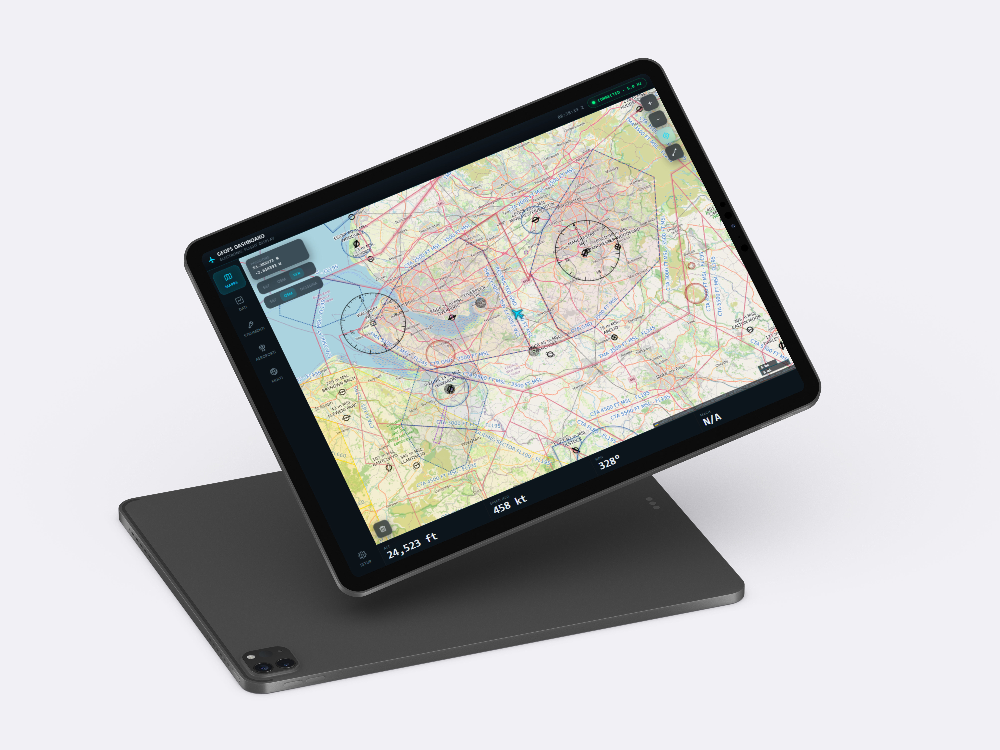
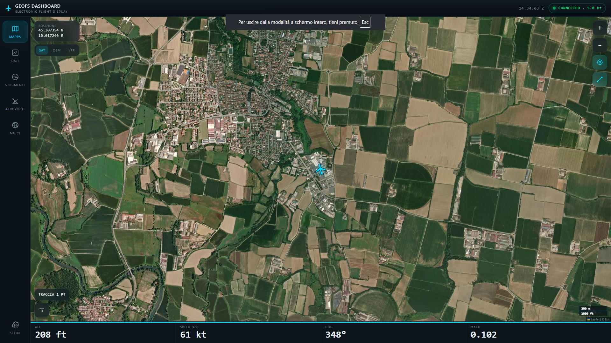
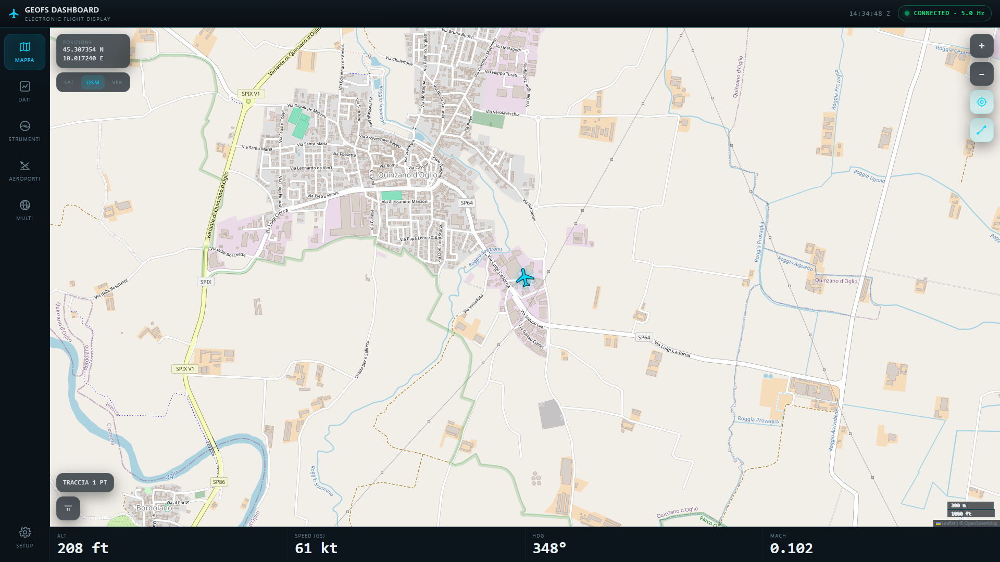
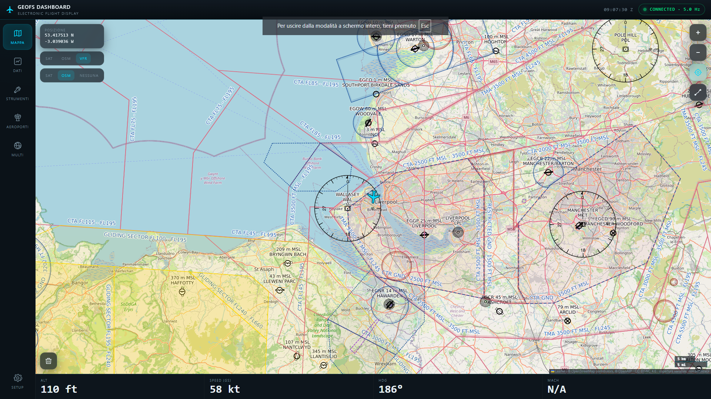
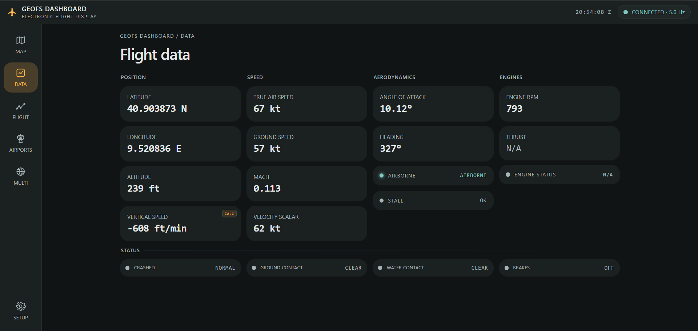
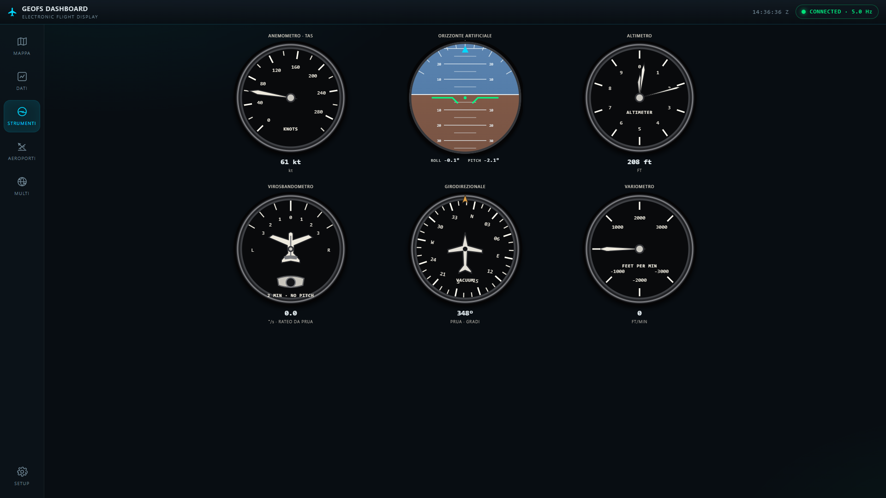
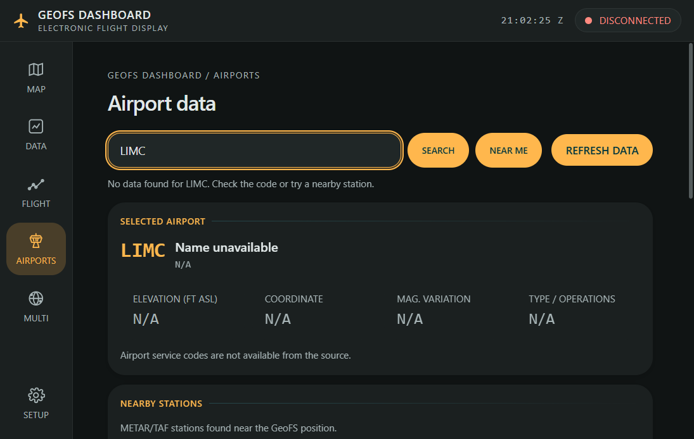
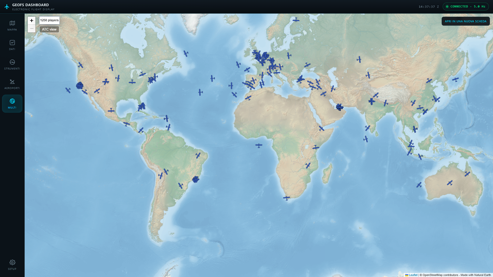

<h1 align="center">GeoFS Dashboard</h1>

<p align="center">
  A local flight dashboard for GeoFS, with live telemetry, maps, and aircraft instruments.
</p>

<p align="center">
  <a href="LICENSE"></a>
  
  
  
</p>

<p align="center">
  
</p>

## Features

- Live position, altitude, speed, heading, attitude, engine, and flight-status data.
- A map with the aircraft position and track, satellite and OpenStreetMap basemaps, and an OpenAIP aeronautical-data overlay.
- A six-pack-style instruments page with an airspeed indicator, attitude indicator, altimeter, turn coordinator, heading indicator, and vertical-speed indicator.
- Optional weather data retrieved from the GeoFS weather service.
- An airports page with live METAR/TAF, airport elevation, runway and radio-frequency data, nearby weather stations, and links to official NOTAM sources.
- A setup page for the data URL, display units, dashboard settings, light/dark theme, Italian/English interface language, and customizable accent color.
- A Windows GUI and an optional one-file Windows executable.

The instruments page uses analog aircraft-style gauges. The autopilot toggle is not part of the dashboard.

## Requirements

- Windows 10 or later is recommended for the included `.bat` scripts and executable build.
- Python 3.10 or later with Tkinter for running the Python GUI. The standard Windows Python installer normally includes Tkinter.
- A supported browser with the Tampermonkey extension to run the GeoFS bridge userscript.
- An internet connection for GeoFS, the weather service, Leaflet, and online map tiles. Leaflet loads asynchronously so the dashboard remains usable while it loads; a canvas map fallback is available if Leaflet cannot be loaded.

Running the server from Python uses only the Python standard library. Building the executable also requires PyInstaller and Pillow; `crea_exe.bat` installs them.

## Run from source

1. Download or clone this repository and extract it.
2. Install Python if it is not already installed. During installation, enable the option to add Python to `PATH`.
3. Open PowerShell or Command Prompt in the project folder.
4. Start the graphical server:

   ```powershell
   python server_gui.py
   ```

5. In the GeoFS Server window, click **Attiva server**. The server listens on port `8080`.
6. On the same computer, open <http://127.0.0.1:8080/> in a browser.

The server can also be started without the GUI:

```powershell
python _server.py
```

## Install the GeoFS bridge

The dashboard needs the userscript to send it data.

1. Install Tampermonkey from <https://www.tampermonkey.net/> in the browser where you use GeoFS.
2. Open the Tampermonkey dashboard and choose **Create a new script**.
3. Replace the editor contents with the contents of [`script_tampermonkey.user.js`](script_tampermonkey.user.js), then save the script.
4. To run the script, you need to modify the extension's settings from the Chrome Web Store and change the **Allow user scripts** option. Go to `chrome://extensions/?id=dhdgffkkebhmkfjojejmpbldmpobfkfo`, open the extension details, and enable **Allow user scripts**.
5. Start the Python server and open GeoFS at one of the supported `geo-fs.com` addresses. Make sure the userscript is enabled.
6. Open the dashboard. Its connection indicator should change from **DISCONNECTED** to **CONNECTED** after GeoFS has loaded and telemetry is being received.

By default, the userscript sends telemetry to `http://127.0.0.1:8080/data`. This is correct when the browser running GeoFS and the server are on the same computer.

### View the dashboard on another device

You can view the dashboard on a tablet or another device on the same trusted local network:

1. Keep the server running on the computer that runs GeoFS.
2. Find that computer's local IPv4 address. The GUI displays an address, or run `ipconfig` in Command Prompt.
3. On the other device, open `http://<computer-ip>:8080/`, replacing `<computer-ip>` with the server computer's address.
4. If the dashboard cannot connect, open **SETUP** and set **Indirizzo dei dati** to `http://<computer-ip>:8080/data`, then save the settings. Allow Python through Windows Firewall on a **private** network if Windows asks.

Dashboard settings are saved in the browser's local storage on that device. Use **SETUP** to adjust units, map options, or the data URL.
The **PERSONALIZZAZIONE** settings let you select the light or dark theme, switch the interface between Italian and English, and choose its accent color. Save the settings to keep your choices on the current device.

### OpenAIP aeronautical map

The map's **VFR** layer displays OpenAIP's worldwide aeronautical-data PNG tiles over the OpenStreetMap basemap. To enable it:

1. Create an OpenAIP account and request an API client/key from your profile. See the [OpenAIP developer documentation](https://www.openaip.net/docs).
2. Open **SETUP**, enter the key under **MAPPA**, and save the settings.
3. Select **VFR** in the map layer controls, then choose **SAT**, **OSM**, or **NESSUNA** as the background beneath OpenAIP.

The key is stored in this browser's local storage and sent to OpenAIP with tile requests over HTTPS. It is not stored in the project files, but local storage is not encrypted; do not configure the key in a shared browser profile. Never paste a real key into source code or commit it. If a key has already been published, revoke it and create a replacement.

OpenAIP data coverage varies by region and is community-maintained. This layer is not an official aeronautical chart and is not certified or intended for navigation. OpenAIP data is licensed under [CC BY-NC 4.0](https://creativecommons.org/licenses/by-nc/4.0/); check the license before commercial use. The existing satellite and OpenStreetMap basemaps remain available without an OpenAIP key.

## Build the Windows executable

From the project folder, run:

```bat
crea_exe.bat
```

The script installs or updates PyInstaller and builds a windowed, one-file executable at `dist\GeoFS_Server.exe`, using the existing `icon\icon.ico`. The generated `build/` and `dist/` folders are local build output and are excluded from Git by `.gitignore`.

To keep build packages separate from other Python projects, create and activate a virtual environment in Command Prompt before running the batch file:

```bat
py -m venv .venv
.venv\Scripts\activate.bat
crea_exe.bat
```

The executable bundles the dashboard and can be run without installing Python on the target computer. Windows may show a security warning for an unsigned executable; only run builds you trust.

## Privacy and network security

- The server binds to `0.0.0.0:8080`, so it is reachable from other devices on the local network. It has no authentication or HTTPS, and it allows cross-origin requests. Do not expose port `8080` to the public internet or use the server on an untrusted network.
- The userscript sends simulator data, including latitude, longitude, and altitude, to the configured server. The server keeps the latest values in memory and prints position values to its console log.
- The userscript requests weather data from `weather.geo-fs.com` using the simulated aircraft's latitude and longitude.
- METAR, TAF, and station lookups use AviationWeather.gov. Airport records, runways, and frequencies fall back to the OurAirports public datasets when AWC has no airport record. NOTAMs are not retrieved in the dashboard; use the official aviation-information service for the country concerned.
- The dashboard loads Leaflet from `unpkg.com` and map tiles from OpenStreetMap, Esri, or OpenAIP. OpenAIP receives the configured API key with VFR tile requests. These services may receive network requests from your browser when the dashboard is used.
- This project is not affiliated with or endorsed by GeoFS or its operators.

## Screenshots



*Map: satellite view for following the aircraft position and track.*


*Map: OpenStreetMap as the cartographic basemap.*


*Map: OpenAIP aeronautical data; coverage varies and is not certified for navigation.*


*Data: detailed position, speed, aerodynamics, engine, and aircraft-status telemetry.*


*Instruments: analog six-pack with airspeed, attitude, altitude, turn rate, heading, and vertical speed.*


*Airports: airport details, runways, frequencies, METAR, and TAF, with links to official NOTAM sources.*


*Multi: GeoFS multiplayer map, also available in a separate browser tab.*

## Project files

- `_server.py`: HTTP server and telemetry endpoint.
- `server_gui.py`: Tkinter GUI for starting and stopping the server.
- `dashboard.html`: browser dashboard.
- `script_tampermonkey.user.js`: GeoFS userscript that sends telemetry.
- `crea_exe.bat` and `GeoFS_Server.spec`: Windows executable build files.
- `geofs_dashboard.bat`: optional command-line server launcher.
- `CHANGELOG.md`: notable dashboard and server changes.
- `icon/icon.ico`: application icon used by the build process and GUI.

## Credits and license

### Project code

Original code in this repository is licensed under the MIT License; see [LICENSE](LICENSE). This license applies only to the project's original code and does not relicense third-party software, map tiles, data, trademarks, or services listed below.

### Third-party software, data, and services

- **OpenAIP:** VFR aeronautical tiles and data. Credit [OpenAIP](https://www.openaip.net/); OpenAIP data is licensed under [CC BY-NC 4.0](https://creativecommons.org/licenses/by-nc/4.0/). The API and tile service have separate usage requirements; see the [developer documentation](https://www.openaip.net/docs).
- **OpenStreetMap:** map data © [OpenStreetMap contributors](https://www.openstreetmap.org/copyright), available under the [ODbL 1.0](https://opendatacommons.org/licenses/odbl/). The public tile service is separately governed by its [Tile Usage Policy](https://operations.osmfoundation.org/policies/tiles/).
- **Esri World Imagery:** imagery service attribution: “Source: Esri, Vantor, Earthstar Geographics, and the GIS User Community.” Use is subject to [Esri's terms](https://goto.arcgisonline.com/maps/World_Imagery); the imagery is not part of this repository and is not relicensed under MIT.
- **Leaflet 1.9.4:** mapping library, licensed under the [BSD 2-Clause License](https://github.com/Leaflet/Leaflet/blob/main/LICENSE).
- **Aviation Weather Center (NOAA):** source for METAR, TAF, station, and airport API information; see the [API documentation](https://aviationweather.gov/data/api/).
- **OurAirports:** fallback source for airport, runway, and frequency datasets. Its data is released to the public domain with no accuracy or fitness guarantee; see [data and terms](https://ourairports.com/data/).
- **GeoFS:** external flight simulator, multiplayer map, and weather endpoint used by the bridge. GeoFS names, marks, and service content belong to their respective owners. This project is not affiliated with or endorsed by GeoFS; see [GeoFS terms](https://www.geo-fs.com/pages/terms.php).
- **Tampermonkey:** third-party browser extension required to run the userscript; see [Tampermonkey](https://www.tampermonkey.net/).
- **PyInstaller and Pillow:** optional third-party tools used by the Windows executable build; see the [PyInstaller license](https://github.com/pyinstaller/pyinstaller/blob/develop/COPYING.txt) and [Pillow license](https://github.com/python-pillow/Pillow/blob/main/LICENSE).
- **FAA NOTAM Search and EUROCONTROL EAD:** external links only; this dashboard does not retrieve or redistribute their NOTAM data.

The map displays provider attribution alongside the active map layer. Provider terms and data coverage can change; review the linked terms before redistribution or commercial use. These credits are a summary, not a legal guarantee.

- Project code and dashboard developed with assistance from GitHub Copilot.